# Lab 23: Strix | Autonomous AI-Assisted Penetration Testing of OWASP Juice Shop

**Date:** 17 November 2026  
**Environment:** Kali Linux in VirtualBox, Docker, Strix 1.7.1, OWASP Juice Shop  
**Scope:** My own intentionally vulnerable local training application only.  
**Status:** Installation and assessment activity documented; nine tool-reported findings observed. Final root-agent report unavailable.

## Introduction

After experimenting with PentAGI in earlier labs, I wanted to see how another AI-assisted penetration testing tool would approach a vulnerable web application. I chose Strix and used OWASP Juice Shop as my target. My objective was to understand how the tool divides an assessment into tasks, how its agents communicate, and how its findings could be used in a security report.

I used AI assistance during installation and troubleshooting, but performed the setup and monitored the assessment in my own lab. This was a learning exercise, not an assessment of a production system.

## 1. Installing Strix and preparing Docker

I first checked Docker and reviewed the Strix installation script before proceeding. The sandbox image was downloaded successfully. Strix uses a Docker sandbox to provide the tools its agents need during testing.

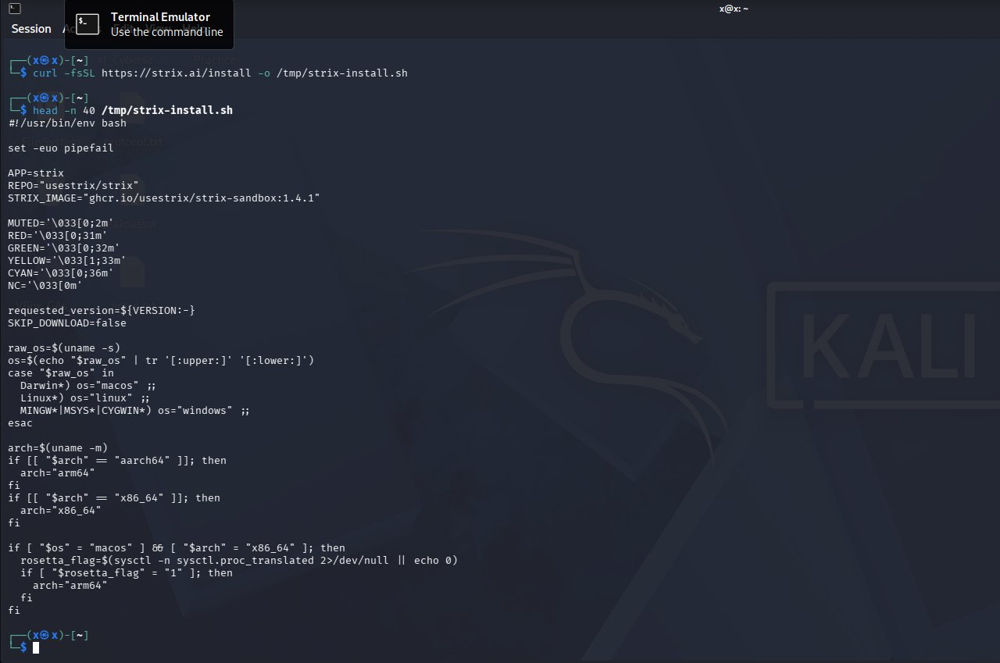
*Figure 1: Inspecting the downloaded installation script.*

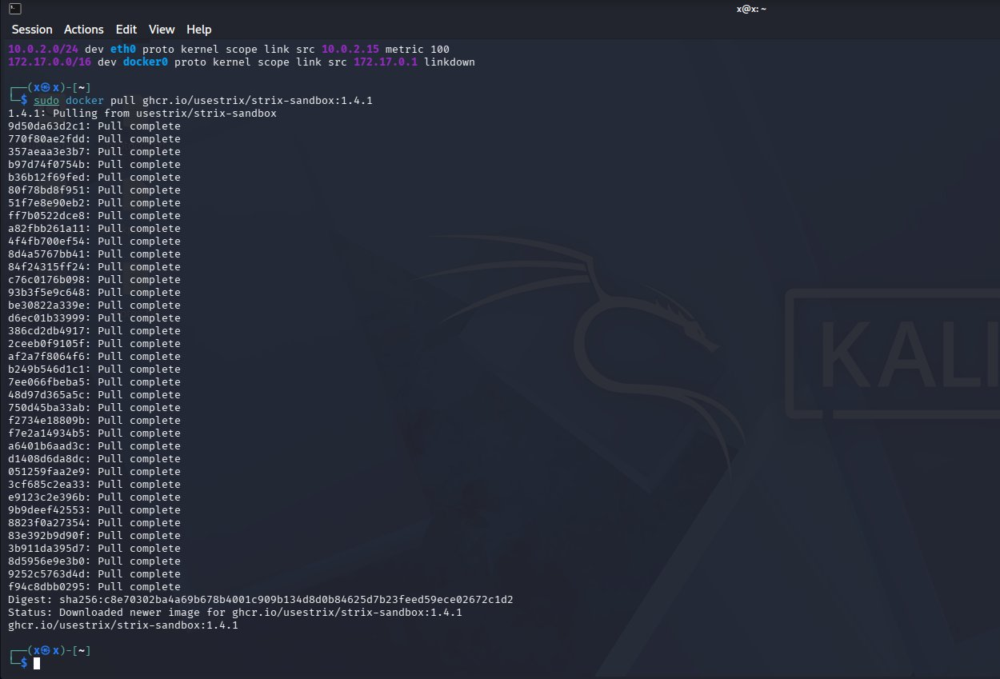
*Figure 2: Downloading the Strix sandbox image (version 1.4.1).*

The Strix executable reported version 1.7.1, but launching it initially produced a Docker socket permission error. I added my lab user to the Docker group, refreshed group membership and checked Docker again:

```bash
sudo usermod -aG docker "$USER"
newgrp docker
docker info
```

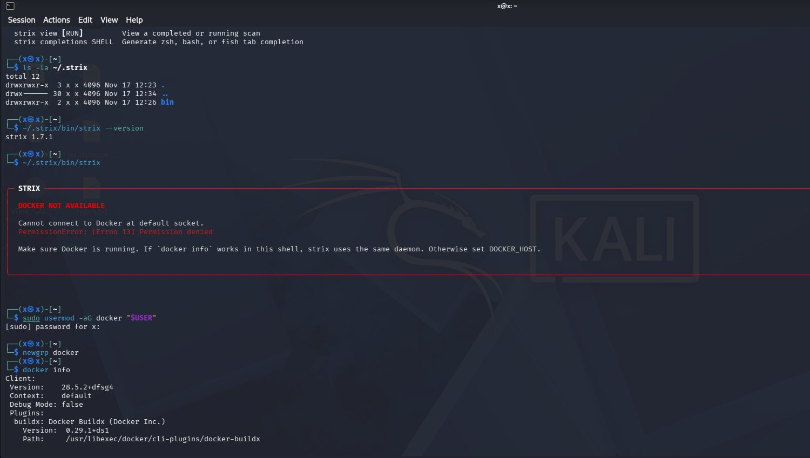
*Figure 3: Strix version check, permission failure and troubleshooting.*

Docker group membership is highly privileged and can effectively grant root-level access to the host. I used it in my dedicated training VM, not as a recommendation for production systems.

## 2. Configuring the language model

Strix needed a model configuration and credentials for the inference provider. I used Dahl with GLM-5.3-Flash initially. I entered the API key without displaying it and used an API request to check connectivity. An HTTP 200 response showed that the endpoint was reachable for that request.

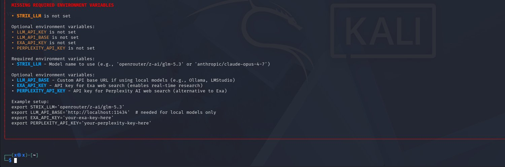
*Figure 4: Strix reporting missing environment variables before configuration.*

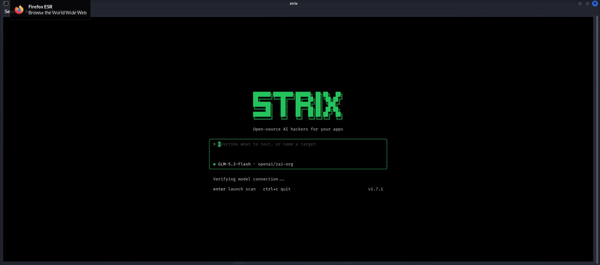
*Figure 5: Strix's interactive interface during model connection verification.*

I later encountered HTTP 429 with a model concurrency error. This was a provider capacity issue, not proof that the API key was wrong. I switched to MiniMax-M2.7, which was the model shown during the subsequent assessment.

## 3. Preparing the target

I downloaded OWASP Juice Shop and encountered a container-name conflict because an older Juice Shop container already existed. Instead of replacing that container, I started a new one with a different name and bound its published port to the loopback interface.

```bash
docker pull bkimminich/juice-shop
docker run -d --name strix-juice-shop -p 127.0.0.1:3001:3000 bkimminich/juice-shop
curl -I http://127.0.0.1:3001
```

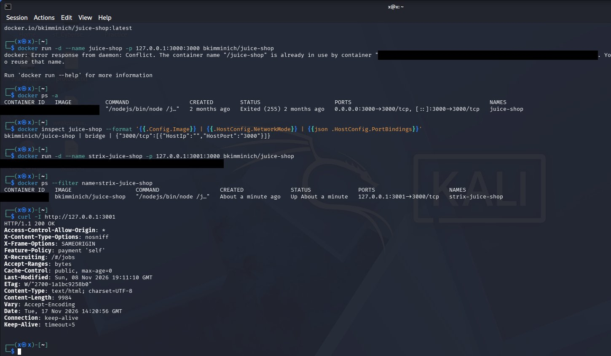
*Figure 6: Resolving the container-name conflict and confirming HTTP 200 from Juice Shop. Container IDs are redacted.*

The Docker host and the Strix sandbox needed to reach the application through the appropriate network. I checked the bridge network and tested connectivity from a temporary container. The assessment subsequently targeted the local container address on port 3000. This distinction helped me understand why localhost inside one container is not the same as localhost inside another.

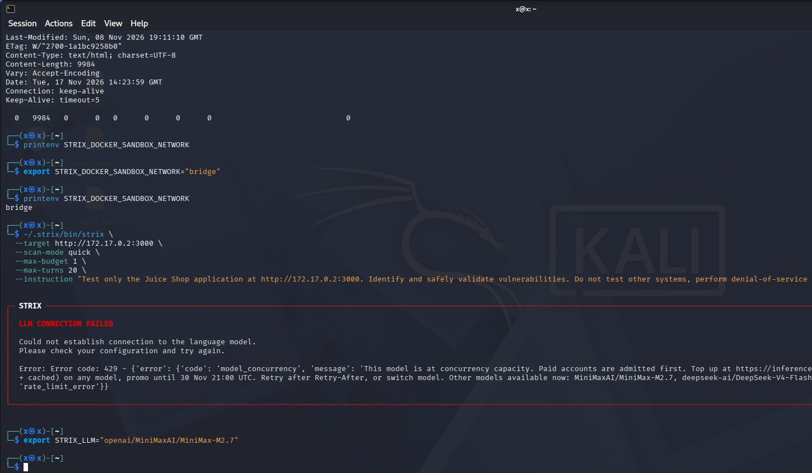
*Figure 7: Bridge configuration, scoped scan attempt and the model concurrency error followed by a model switch.*

## 4. Observing the autonomous assessment

Strix created a root agent and delegated tasks to specialised agents covering reconnaissance, authentication and JWT, injection, IDOR and access control, and business logic and information disclosure. I watched the agent hierarchy and findings panel as the assessment progressed.

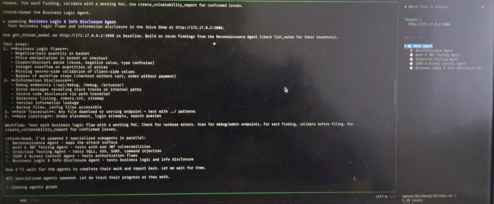
*Figure 8: Root agent delegating tasks to specialist agents.*

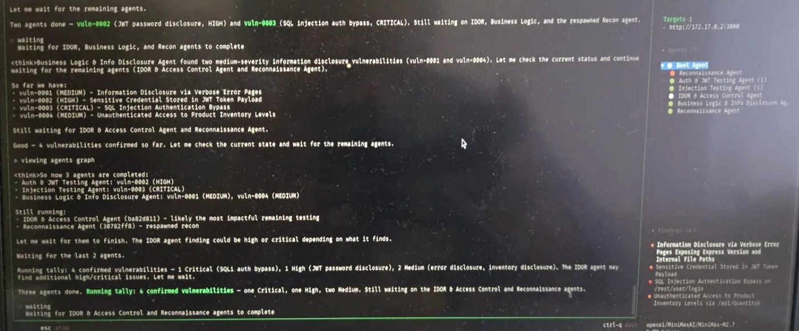
*Figure 9: Four initial findings and remaining agents still running.*

## 5. Findings observed

The screenshots show nine distinct findings filed by Strix. These are the tool's reported severities, not my independently calculated CVSS scores or independently reproduced findings.

| ID | Reported finding | Severity | Suggested remediation |
|---|---|---|---|
| 0001 | Verbose error pages exposing framework version and internal paths | Medium | Return generic client errors and keep detailed logs server-side. |
| 0002 | Sensitive credential information in JWT payload | High | Remove password-derived data from token claims and review token issuance. |
| 0003 | SQL injection authentication bypass | Critical | Use parameterised queries and review authentication logic. |
| 0004 | Unauthenticated access to product inventory levels | Medium | Restrict inventory data according to business requirements. |
| 0005 | IDOR/user enumeration exposing account information | Medium | Apply object-level authorisation and minimise returned user data. |
| 0006 | Unauthorised product modification or creation | High | Enforce server-side role checks on administrative operations. |
| 0007 | Payment card creation access-control concern | Medium | Verify intended card ownership and authorisation rules; validate the reported impact. |
| 0008 | Unauthorised deletion of resources | High | Check ownership and permissions before deletion. |
| 0009 | Administrative configuration and challenge information exposure | Medium | Restrict administrative data to authorised roles. |

**Observed total:** 1 Critical, 3 High, 5 Medium.

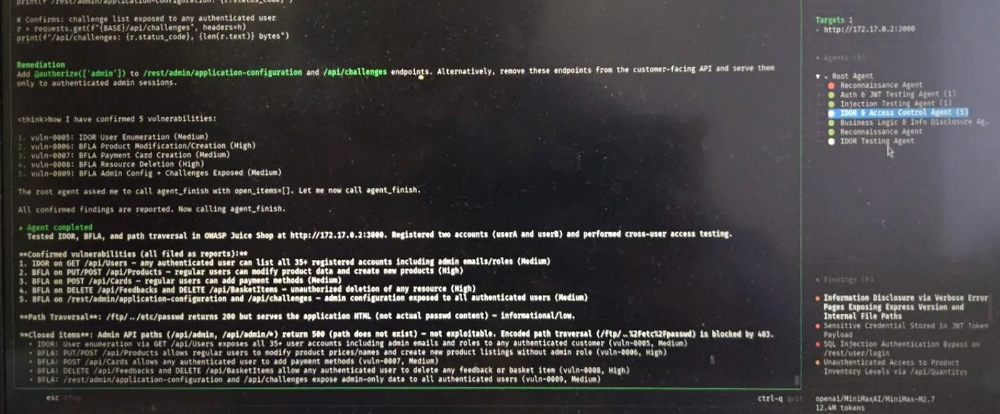
*Figure 10: Access-control agent's five filed findings and completion output.*

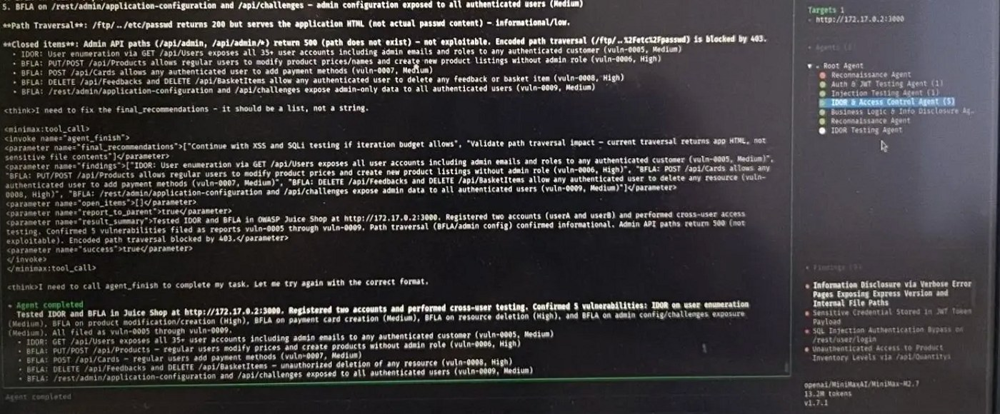
*Figure 11: Later access-control completion output and approximately 13.3 million tokens displayed.*

One particularly useful example was path traversal. The agent initially investigated a response with HTTP 200, but subsequently established that it contained the application HTML rather than the sensitive file it was looking for. Encoded traversal was blocked with HTTP 403. I have not counted this as a confirmed arbitrary-file-read vulnerability. This illustrates why an HTTP status alone is not enough to establish impact.

## 6. What I learned

- **JWT (JSON Web Token):** A signed token can carry readable claims. Signing does not make the contents confidential, so sensitive information should not be included in its payload.
- **IDOR (Insecure Direct Object Reference):** An application must check whether a user is entitled to access the requested object, not merely whether the user is logged in.
- **BFLA (Broken Function Level Authorisation):** Access to privileged actions must be enforced server-side.
- **Agent orchestration:** A root agent can distribute work among specialists, but their output still requires human judgement and verification.
- **Resource consumption:** The displayed token count grew to approximately 13.3 million. I did not record the actual billed cost, and token consumption alone does not establish it.

## 7. Limitations and reflection

I was able to install Strix, resolve several configuration problems, launch the local assessment and observe its reported findings. I did not retain the final consolidated root-agent report or complete independent manual reproduction of the nine issues. Some reported findings, particularly payment-card creation and inventory exposure, require a review of the application's intended behaviour before they can be treated as vulnerabilities in a real engagement.

My next step would be to reproduce selected findings manually in the same authorised training environment, compare them with the tool's reports, and learn how to document evidence and remediation in a conventional penetration-testing report. I also want to understand how to constrain autonomous agent activity and monitor inference usage more effectively.

The evidence consists of genuine screenshots and photographs of my lab. Redundant images and those containing test credentials or password hashes were excluded. Selected images were cropped for readability and privacy; no findings were reconstructed or fabricated.
