# Lab 25: Google Cloud Security 01 | Cloud Administration, IAM and Budget Automation

**Date:** 25 November 2026  
**Environment:** Ubuntu (VirtualBox), Google Cloud CLI 594.0.1 and Google Cloud Console  
**Status:** Administration and dry-run integration tests completed; cloud deployment not completed.

## Introduction

In this lab, I continued my introduction to Google Cloud Platform (GCP). I wanted to become more comfortable managing cloud resources from the terminal and understand how access permissions, billing and different cloud services fit together.

I followed the classroom exercises and used AI assistance for troubleshooting, explanations and the additional Python automation exercise. I ran the commands in my own environment and checked the results as I progressed. The automation component is an extension of the lab, not a deployed production system.

## 1. Setting up the Google Cloud CLI

I used Ubuntu in VirtualBox and installed the Google Cloud CLI. I initially had difficulty with the shared clipboard, so I resolved that before proceeding with the installation and configuration.

```bash
sudo snap install google-cloud-cli --classic
gcloud --version
gcloud init
```

The version output confirmed that the installation was successful. I then authenticated using my Google account and created a dedicated training project.

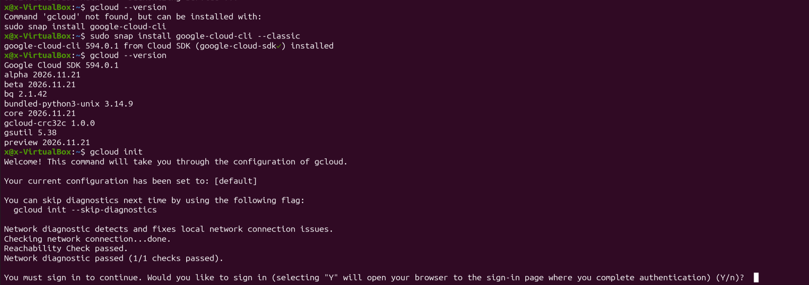

*Figure 1. CLI installation, version check and initial configuration.*

I learned that the CLI gives me another way to manage the same Google Cloud resources that I can access from the browser. It is not a separate cloud environment.

## 2. Managing projects

I created a separate practice project to learn how to create, select, delete and restore projects without using my main training project for the deletion exercise. I also experimented with `gcloud alpha interactive` to see how command suggestions work.

```bash
gcloud projects list
gcloud projects create PRACTICE_PROJECT_ID --name="Practice Project"
gcloud config set project PRACTICE_PROJECT_ID
gcloud config get-value project
gcloud config set project LAB_PROJECT_ID
gcloud projects delete PRACTICE_PROJECT_ID
gcloud projects undelete PRACTICE_PROJECT_ID
gcloud projects describe PRACTICE_PROJECT_ID
```

The identifiers in the commands above are placeholders. After restoring the practice project, I confirmed that its lifecycle state was `ACTIVE`.

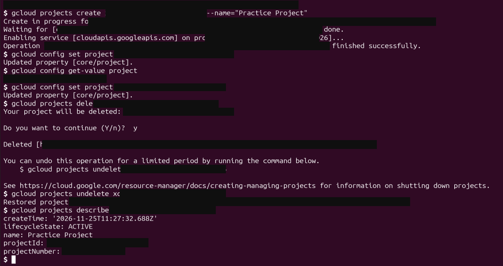

*Figure 2. Project lifecycle exercise and confirmation that the restored project was active.*

## 3. Billing setup and troubleshooting

Before creating billable infrastructure, I wanted to understand how to monitor cloud spending. I encountered an HTTP 429 `RESOURCE_EXHAUSTED` error while checking the billing configuration. The request was rate-limited; a later attempt succeeded, although I did not establish the underlying cause of the rate limit.

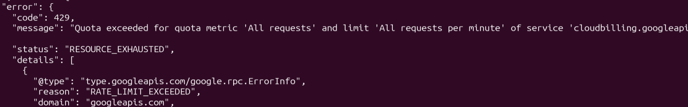

*Figure 3. Rate-limit error encountered during the billing check.*

The billing overview displayed a $300 welcome credit with 90 days remaining, while another part of the console said that the free trial was over. Because those messages were inconsistent, I did not assume that all services could be used without charges.

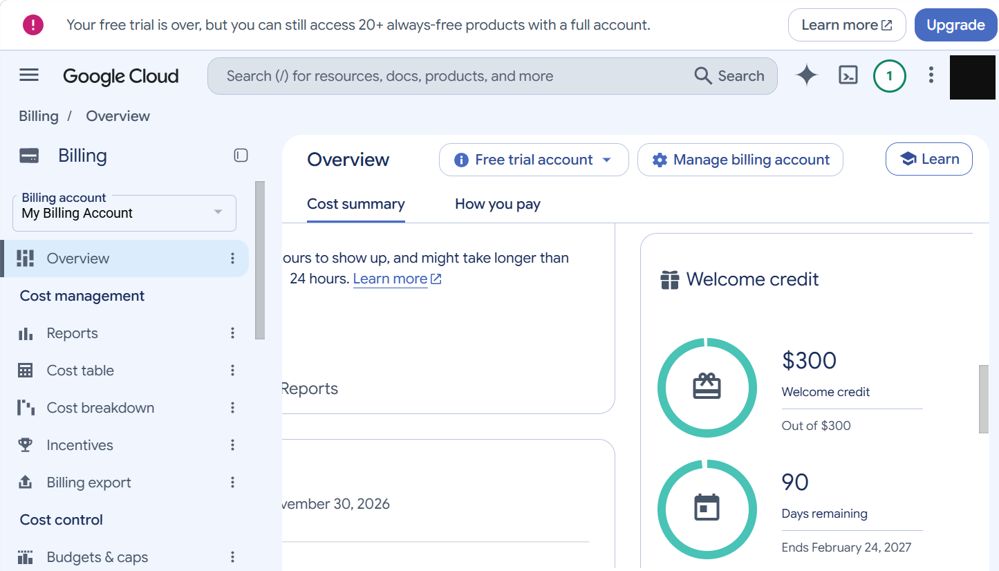

*Figure 4. Inconsistent trial information in the billing console.*

I linked the training project to the billing account using the console, returned to Ubuntu and checked the configuration:

```bash
gcloud billing projects describe LAB_PROJECT_ID
```

The output returned `billingEnabled: true`, confirming that the project was linked to billing. This did not establish the status of the promotional credit.

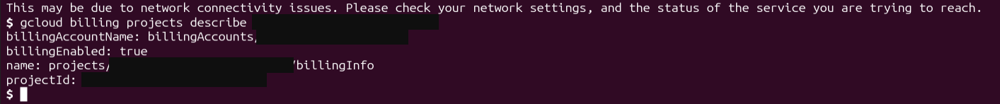

*Figure 5. Billing enabled for the training project.*

## 4. Enabling APIs and configuring the region

I initially attempted to set a default Compute Engine region, but the API was not enabled and the interactive prompt did not complete. I returned to the ordinary Ubuntu terminal and enabled it directly.

```bash
gcloud services enable compute.googleapis.com
gcloud config set compute/region us-central1
gcloud config get-value compute/region
gcloud services enable cloudbilling.googleapis.com
```

I selected `us-central1` for the training environment because some Google Cloud Free Tier compute resources are available in that region. I did not create a virtual machine during this exercise. Enabling an API allows the project to interact with that service; it is not the same as deploying a resource.

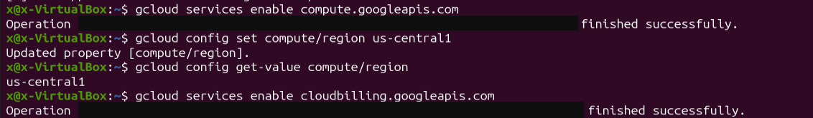

*Figure 6. Successful API enablement and confirmation of the default region.*

## 5. Identity and Access Management (IAM)

I created a service account named `budget-alert`. The idea was to give a future billing automation its own identity rather than using my personal Google credentials.

```bash
gcloud iam service-accounts create budget-alert --display-name="Budget Alert Service Account"
gcloud iam service-accounts list
gcloud projects add-iam-policy-binding LAB_PROJECT_ID \
  --member="serviceAccount:budget-alert@LAB_PROJECT_ID.iam.gserviceaccount.com" \
  --role="roles/billing.projectManager"
```

I assigned the Project Billing Manager role at project level. This is a privileged role, but I did not grant the service account the broader Owner role. The service account was not yet attached to a deployed application.

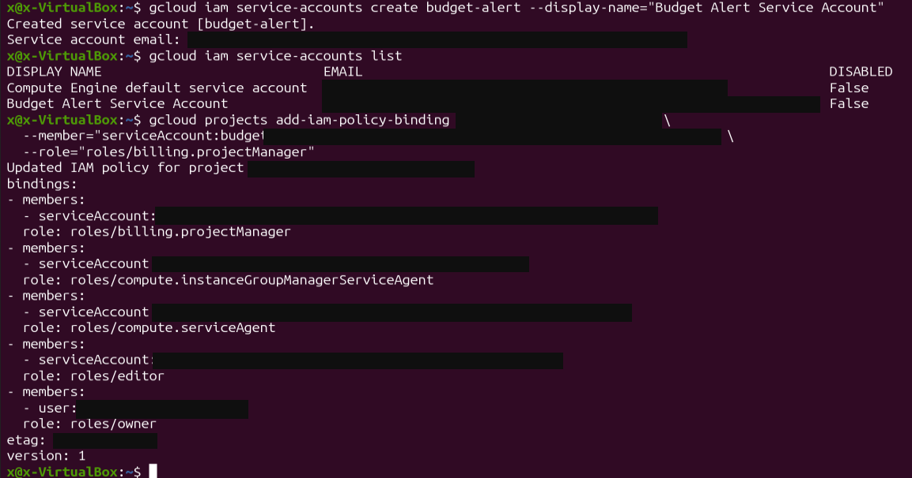

*Figure 7. Service accounts and successful IAM policy update. Account identifiers have been redacted.*

One thing I noticed in the IAM policy was that the default Compute Engine service account had the Editor role. This helped me understand why it is important to review default permissions and apply the principle of least privilege. I did not change that default account's permissions during this lab.

## 6. Testing Pub/Sub

I enabled the Pub/Sub API and created a topic called `budget-alerts`. To understand the difference between a topic and a subscription, I created a temporary subscription, published a test message and retrieved it.

```bash
gcloud services enable pubsub.googleapis.com
gcloud pubsub topics create budget-alerts
gcloud pubsub subscriptions create budget-alerts-test --topic=budget-alerts
gcloud pubsub topics publish budget-alerts --message="Hello from my cloud security lab"
gcloud pubsub subscriptions pull budget-alerts-test --auto-ack --limit=1
```

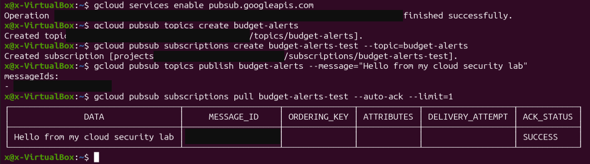

*Figure 8. The test message was received with an acknowledgement status of SUCCESS.*

I now understand that a topic is where messages are published, while a subscription provides a way to receive those messages. After the test, I deleted the temporary subscription but retained the topic.

## 7. Configuring budget alerts

I created two monthly budget rules using the Google Cloud Console. The first monitors the billing account, while the second applies only to my training project. Both were set to $5 with actual-spend alert thresholds of 50%, 90% and 100%.

| Budget | Scope | Monthly target |
|---|---|---:|
| Cloud Lab Budget | Billing account | $5 |
| Cloud Lab Automation Budget | Training project | $5 |

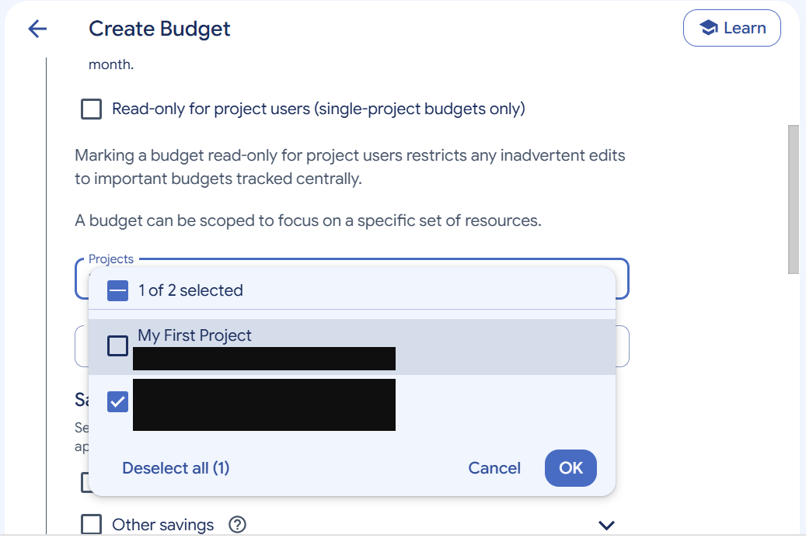

*Figure 9. Selecting only the training project for the automation budget.*

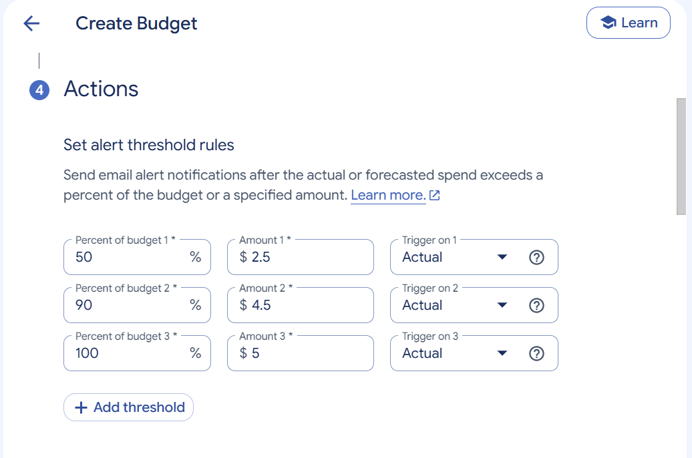

*Figure 10. Configuring alerts at $2.50, $4.50 and $5.*

The second budget was connected to the `budget-alerts` Pub/Sub topic. The purpose was to make budget information available for a future automated response.

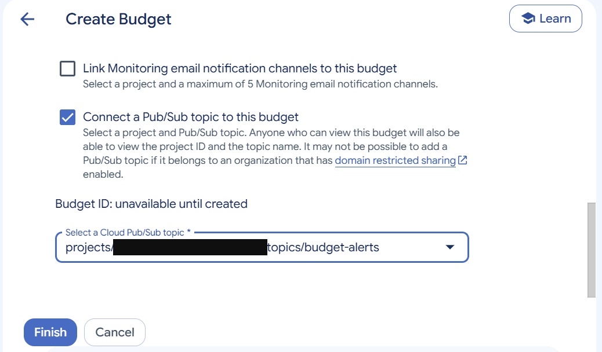

*Figure 11. Selecting the topic created earlier through the CLI.*

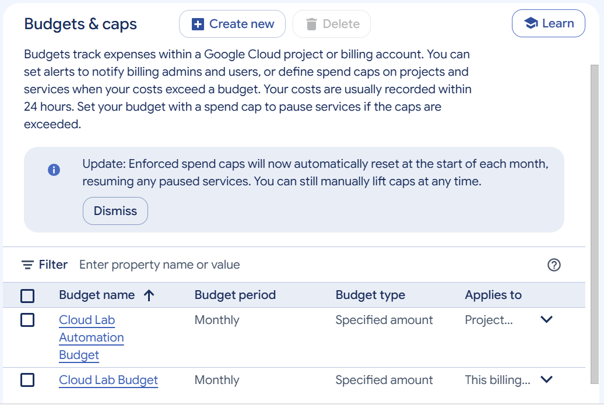

*Figure 12. Confirmation that both budget rules had been created.*

I learned that a budget alert does not automatically stop services when spending reaches the specified amount. Billing information can also be delayed. The $5 threshold is therefore a monitoring rule, not a guaranteed spending cap.

## 8. Extending the lab: Python budget automation

With AI assistance, I developed a small Python prototype to explore how a program could respond to a budget notification. I created a working directory and used Nano to edit `main.py`.

```bash
mkdir -p ~/cloud-budget-automation
cd ~/cloud-budget-automation
nano main.py
python3 main.py
```

The script reads a simulated Pub/Sub message, decodes its Base64 data, parses the JSON and compares the spending amount with the budget. If spending reaches or exceeds the budget, it prints a dry-run message instead of actually disabling billing.

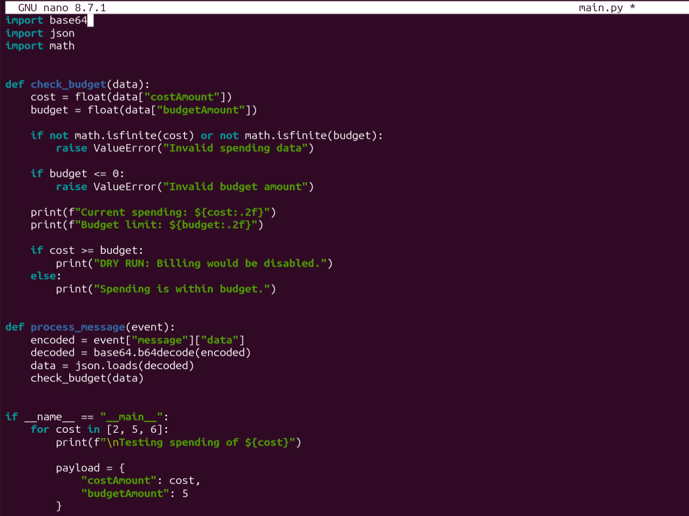

*Figure 13. Python code for message decoding, input validation and budget evaluation.*

The [Python source](main.py) is included in this repository. It uses standard Python libraries and contains no billing API calls. Base64 is an encoding format, not encryption.

I tested spending below, at and above the threshold. I also deliberately supplied a budget of zero to check that the program rejected invalid input.

| Test input | Expected behaviour | Observed result |
|---|---|---|
| $2 spending / $5 budget | Within budget | Pass |
| $5 spending / $5 budget | Simulate shutdown | Pass |
| $6 spending / $5 budget | Simulate shutdown | Pass |
| $6 spending / $0 budget | Reject invalid budget | Pass |

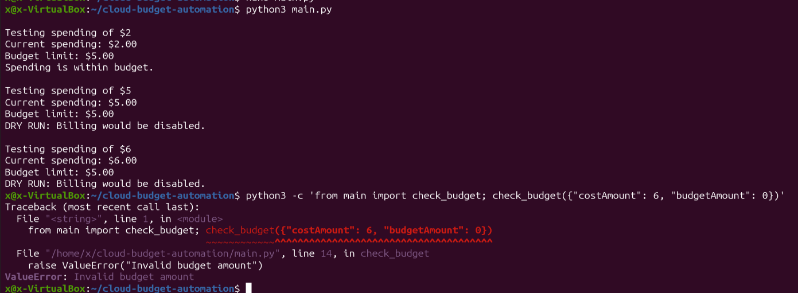

*Figure 14. Successful local tests, including the expected ValueError for an invalid budget.*

## 9. Cloud-to-local integration test

Rather than stopping at local test data, I recreated the temporary subscription and sent a synthetic billing message through the actual Pub/Sub service. I saved the retrieved message to a local JSON file, then passed it to the Python function.

```bash
gcloud pubsub subscriptions create budget-alerts-test --topic=budget-alerts
gcloud pubsub topics publish budget-alerts --message='{"costAmount":6,"budgetAmount":5}'
gcloud pubsub subscriptions pull budget-alerts-test --auto-ack --limit=1 --format=json > message.json
python3 -c 'import json; from main import process_message; process_message(json.load(open("message.json"))[0])'
```

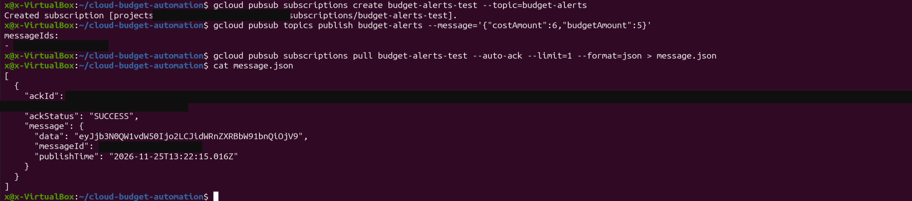

*Figure 15. JSON response from Pub/Sub. The acknowledgement and message identifiers have been redacted.*

The script successfully decoded the retrieved data, identified spending of $6 against the $5 budget and printed `DRY RUN: Billing would be disabled.` I then deleted the temporary test subscription.

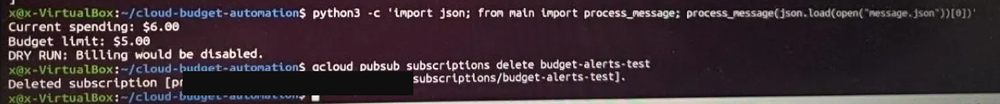

*Figure 16. Final terminal output, captured in a photograph of the screen, showing the successful dry run and subscription cleanup.*

This was a manually triggered integration test using simulated spending data. It did not test a genuine Google-generated billing notification or actually disconnect the billing account.

## 10. What I learned and next steps

This lab helped me understand how project administration, service accounts, permissions, billing and messaging relate to each other. I found it particularly useful to see a message move from Google Cloud into a local Python program and produce a response based on its contents.

I am still learning the deployment side of cloud automation. I decided to stop at the working prototype so that I could consolidate the material before attempting to deploy a Cloud Run function. A future exercise could verify genuine budget notifications, validate the budget identity and currency, handle duplicate or malformed events, review the service account permissions and clarify the trial status before deploying anything. Automatically disabling billing can interrupt services and is not an exact spending cap.

At the end of this lab, I had configured project-level budget monitoring and verified a dry-run message processing workflow. The proposed automatic shutdown mechanism was **not deployed or activated**.

## Evidence and privacy

Screenshots are from my lab session. Redundant intermediate screens were excluded, and selected screenshots were cropped or permanently redacted to remove personal email addresses, billing identifiers, project identifiers, service account addresses and acknowledgement IDs. The raw billing message file and payment or authentication screens are not included.
